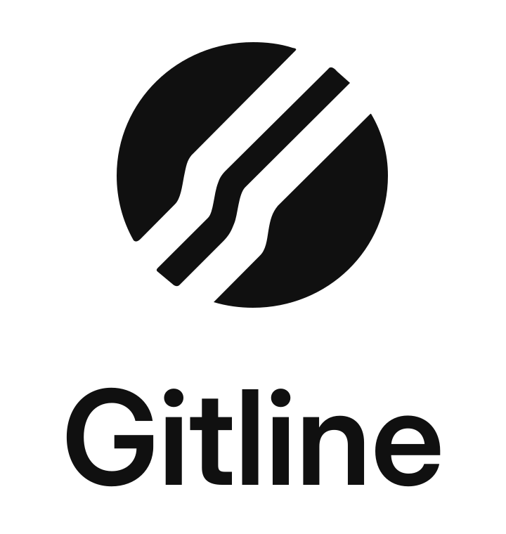

# Gitline

<picture>
  <source media="(prefers-color-scheme: dark)" srcset="docs/assets/gitline-logo-dark.svg">
  
</picture>

**Your repos. In line.**

**Automatically create and maintain Linear projects for your GitHub repositories.**

GitHub moves fast. Gitline keeps your Linear workspace alongside it, handling project setup, repository connections, and native push hooks as your repos grow and change.

Preview changes, apply them when ready, and let scheduled runs keep everything aligned. Gitline preserves repository identity across renames and resumes interrupted runs.

Built with TypeScript and Effect. Maintained by mynameistito.

## What it adds to Linear

Linear's [native GitHub integration](https://linear.app/docs/github-integration) connects issues, pull requests, and commits. Gitline adds the repository setup and ongoing project maintenance around that integration:

- **Creates and maintains projects for your repositories.** Keeps GitHub repositories matched to Linear projects while preserving stable identities and existing resources across renames.
- **Manages native push hooks.** Manages matching Linear hooks while preserving unrelated webhooks and existing signing secrets.
- **Lets you preview changes.** Run a dry run, inspect the results, then enable and apply mutations.
- **Keeps working through interruptions.** Persists progress and resumes work. A failure on one repository allows the others to continue.
- **Runs on a schedule or on demand.** Supports an hourly schedule and authenticated operator commands.

Archived and disabled repositories are skipped. Ambiguous project matches and duplicate hooks are left for manual inspection.

> **Does this enable two-way issue sync?** Native issue sync and project routing still need manual configuration in the GitHub–Linear integration. Creating a Linear project does not enable them automatically.

## Try it locally

You can run the checks and build without connecting your GitHub or Linear accounts.

Use **Bun 1.4.4** and a Node version supported by Alchemy. From the repository root:

```text
bun install --frozen-lockfile
bun run test
bun run typecheck
bun run check
bun run knip
```

To build without credentials in PowerShell:

```powershell
$env:LINEAR_TEAM_ID = '00000000-0000-4000-8000-000000000000'
bun run build
```

That UUID is a local build fixture. Use your real Linear team UUID when deploying.

## Connect your accounts

The deployment configuration currently identifies an existing maintainer instance. Follow the [setup and operations guide](docs/operations.md) to adapt the account, repository owner, Linear team, Worker identity, and secret references for your own instance.

Gitline was previously named `git2linear`. Existing deployment and state identifiers retain that name to preserve the running instance and its persisted history.

The setup flow is:

1. Configure your deployment identity and provide GitHub, Linear, and manual-trigger credentials. Native push hooks also need the webhook URL and signing secret from Linear.
2. Deploy with mutations disabled (`APPLY_ENABLED=false`).
3. Run a remote dry run and inspect its completed results.
4. Enable mutations and apply the reviewed changes.

Once the deployment and operator environment are configured, use:

```text
bun scripts/operate.ts dry-run
bun scripts/operate.ts status
bun scripts/operate.ts apply
```

Apply requires a successful persisted dry run and enabled mutations. A trigger being accepted does not mean the run has finished; check its status and repository outcomes.

## Explore the project

- [Setup and operations](docs/operations.md) — credentials, deployment, dry runs, and recovery.
- [Architecture](docs/architecture.md) — identity, reconciliation, persisted progress, and safety boundaries.
- [Contributing](CONTRIBUTING.md) — how to work on the project.

Licensed under [MIT](LICENSE).
